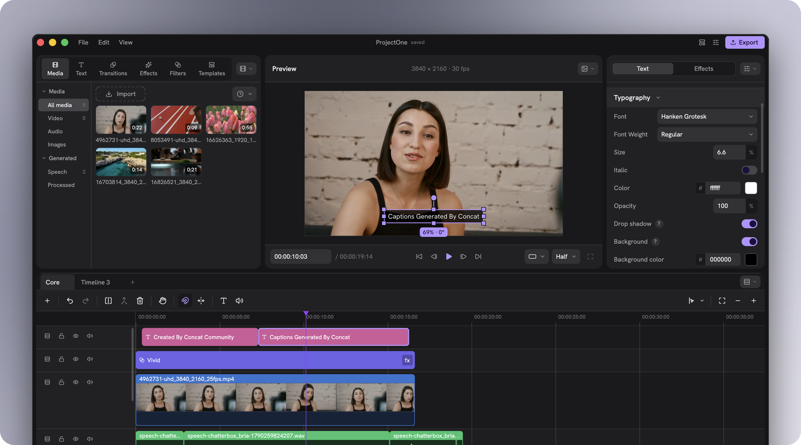

<p align="center">
  
</p>

<h1 align="center">ClipCat</h1>
<h3 align="center">Free, offline-first, professional desktop video editor built in Rust & Slint.</h3>

<p align="center">
  <a href="https://github.com/lyric9901/ClipCat/releases"></a>
  <a href="https://github.com/lyric9901/ClipCat/actions/workflows/ci.yml"></a>
  <a href="https://www.rust-lang.org/"></a>
  <a href="LICENSE"></a>
  
</p>

<div align="center">
  
</div>

---

## Overview

**ClipCat** is an open-source, local-first non-linear video editing (NLE) application engineered for performance, precision, and privacy. Built from the ground up using native Rust and the Slint UI toolkit, ClipCat combines high-efficiency GPU compositing with an unslop dark workspace inspired by professional editors like Premiere Pro and DaVinci Resolve.

### Core Philosophy

- **100% Local & Offline-First:** Core editing, timeline scrubbing, effects processing, audio mixing, color correction, and video export operate completely offline. Your media never leaves your disk.
- **Zero Cloud Friction:** No mandatory account creation, subscriptions, artificial paywalls, or exported watermarks.
- **Predictable Performance:** Native desktop binary designed to run smoothly on everyday hardware budgets (e.g. Intel Core i3 with 8 GB RAM) without unbounded memory growth.
- **Non-Destructive Workflows:** Every cut, trim, transition, and color adjustment is preserved in an undo/redo history tree with atomic project file saving.

---

## Key Features

### 🎬 Professional Multitrack Timeline & Dual Monitors
- **Source & Program Monitors:** Dedicated preview monitors with 3-point editing (`Mark In`, `Mark Out`), frame-accurate scrubbing, and one-key `Insert` and `Overwrite` actions.
- **Multitrack Editing:** Layer unlimited video, audio, title, and adjustment tracks. Includes track locking, soloing, track patching, and magnetic ripple trimming.
- **Precision Trimming:** Full support for razor slicing, ripple cuts, rolling edits, slip, and slide.
- **Speed Ramping:** Smooth cubic Bézier speed curves and time remapping with audio pitch compensation.

### 🎨 Color Grading & Broadcast Video Scopes
- **Integrated Video Scopes:** Real-time hardware-calculated monitoring tools:
  - **Luma Waveform:** 0 to 100 IRE reference lines for exposure evaluation.
  - **RGB Parade:** Side-by-side color channel traces to isolate color casts.
  - **Vectorscope:** Polar chrominance plot with 75% SMPTE color targets and 123° skin-tone reference axis.
  - **RGB + Luma Histogram:** Real-time distribution curves with black-crush and white-clip counters.
- **Color Correction & LUTs:** 3-way color balance wheels, contrast, saturation, shadows/highlights, and custom 3D LUT importing (.cube).

### 🎚️ Studio Audio Mixer
- **Channel Strips:** Dedicated fader tracks with mute/solo, equal-power pan (-3 dB constant acoustic power sum), and stereo peak meters.
- **Loudness Standards:** ITU-R BS.1770-4 K-weighting loudness measurement with an integrated -14 LUFS broadcast/streaming target.
- **Audio Clean-up & Ducking:** Automated background music ducking based on voice speech envelopes, high-pass rumble filtering, and voice denoise.

### ✍️ Kinetic Typography & Motion Graphics
- **Shaped Text Engine:** Bundled static instances of Hanken Grotesk with full RTL and bidirectional script support.
- **Rich Text Properties:** Vector outline stroke, soft drop shadows, background padding plates, and letter spacing.
- **Per-Character Animation:** Staggered letter-by-letter reveal, bounce, and wave kinematics.

### 🪄 AI Creator Automation
- **Silence Detection & Ripple Cut:** Offline RMS energy scanning that identifies audio silence and automatically performs ripple cuts to compact timelines.
- **Beat Snapping:** Transient onset flux analysis to align cuts and transitions directly onto musical beats.

### 📦 Offline Creative Asset Library
- **16-Category Catalog:** Bins, transitions, titles, SFX, music, stickers, LUTs, and motion presets.
- **Local Pack System (`.concatpack`):** Safe, sandboxed offline pack installer with directory-traversal protection.
- **Offline Fallbacks:** Guaranteed access to bundled sound effects and presets even without internet connectivity.

---

## Workspace Layouts

ClipCat supports 6 specialized workspace presets designed for distinct stages of post-production:

| Workspace | Focus & Primary Panels |
|---|---|
| **Editing** | Balanced dual-monitor preview, multitrack timeline, media browser, and clip inspector. |
| **Color** | Centered program monitor, 3-way color grading wheels, curves, and live broadcast scopes. |
| **Audio** | Multitrack audio mixer console, channel strips, LUFS meter, and sound library. |
| **Motion Graphics** | Expanded stage viewport, kinetic typography controls, and Bézier keyframe curve editor. |
| **Effects** | Large shader/filter browser, preview comparison, and applied effect parameter chains. |
| **Custom** | Freely configurable, resizable docked layout tailored to your specific monitor configuration. |

---

## System Requirements

| Specification | Minimum Requirement | Recommended |
|---|---|---|
| **Operating System** | Windows 10/11 (64-bit), Ubuntu 22.04+ / Debian 12+, macOS 12+ | Windows 11 (64-bit), Ubuntu 24.04, macOS 14+ |
| **Processor** | Intel Core i3 10th Gen / AMD Ryzen 3 (4 cores) | Intel Core i5/i7 12th Gen+ / AMD Ryzen 5/7 / Apple Silicon M-series |
| **Memory (RAM)** | 8 GB | 16 GB or higher |
| **Graphics** | Intel UHD Graphics 630 / OpenGL 3.3+ support | NVIDIA GeForce GTX 1660 / AMD Radeon RX 580 / Metal 2+ |
| **Storage** | 2 GB available disk space (SSD recommended) | NVMe SSD for fast video proxy caching |

---

## Installation

### Windows
1. Download the latest installer `ClipCat-Setup-*.exe` or the portable zip archive from **[GitHub Releases](https://github.com/lyric9901/ClipCat/releases)**.
2. Run the installer to place ClipCat in your Start Menu and Desktop.
3. If Windows SmartScreen prompts on an unsigned build, click **More info** → **Run anyway**.

### Linux
Download the `.AppImage` or `.deb` package from the Releases page:
```bash
chmod +x ClipCat-*.AppImage
./ClipCat-*.AppImage
```

### macOS
Download the `.dmg` package from GitHub Releases and drag `ClipCat.app` to your Applications folder.

---

## Building from Source

### Prerequisites
- **Rust Toolchain:** Version 1.93 or newer (`rustup default stable`).
- **C/C++ Compiler & CMake:** GCC / Clang or MSVC C++ Build Tools.
- **FFmpeg 7+ Development Libraries:** Header files and import libraries for `libavcodec`, `libavformat`, `libavutil`, `libswscale`, `libswresample`.

### Build Commands

```bash
# 1. Clone the repository
git clone https://github.com/lyric9901/ClipCat.git
cd ClipCat

# 2. Run automated test suite
cargo test --manifest-path src/Cargo.toml -p concat-project -p concat-core -p concat-effects -p concat-text

# 3. Build optimized release binary
cargo build --manifest-path src/Cargo.toml --release --bin concat
```

---

## Architecture Overview

ClipCat is organized as a modular Cargo workspace:

```
src/crates/
├── concat-core/      # Frame buffers, timecode math, audio DSP (LUFS/ducking/pan), scopes, AI silence
├── concat-project/   # Document model, tracks, clips, keyframes, undo/redo, asset database, workspaces
├── concat-effects/   # GPU shader execution, GLSL/WGSL pipelines, color grading, transition blends
├── concat-text/      # Typography shaping, font rendering, vector text plates, RTL support
├── concat-render/    # Frame compositing, multi-track blending, shader graphs, video scopes renderer
├── concat-export/    # Video export pipeline, hardware/software encoders, format muxers
└── concat/           # Desktop application binary, Slint UI layout, audio hardware routing, dock manager
```

---

## Mobile Availability

ClipCat is currently built and optimized as a **desktop workstation application** for Windows, Linux, and macOS. 

While experimental mobile targets exist in the codebase, **production mobile packages (Android APK / iOS IPA) are not published for general release at this time**. Mobile support remains experimental and will be released separately once touch gestures, hardware decoder constraints, and phone layouts are validated.

---

## Contributing

Contributions from the open-source community are welcome!

1. Check existing issues or open a new discussion before starting major architectural changes.
2. Follow Rust idioms and maintain documentation integrity.
3. Format code with `cargo fmt` and verify with `cargo clippy`.
4. Ensure all unit and integration tests pass before submitting a pull request:
   ```bash
   cargo test --manifest-path src/Cargo.toml --workspace
   ```

See [CONTRIBUTING.md](CONTRIBUTING.md) for full guidelines.

---

## License

ClipCat is free software licensed under the **GNU Affero General Public License Version 3 (AGPL-3.0-or-later)**. See the [LICENSE](LICENSE) file for details.

## Acknowledgements

ClipCat is built on the foundation of the open-source video editor **Concat**, created by Jareer Abdullah and contributors. We thank the upstream authors and the developers of [Slint](https://slint.dev), [FFmpeg](https://ffmpeg.org), and the Rust ecosystem for making native desktop media software possible.
